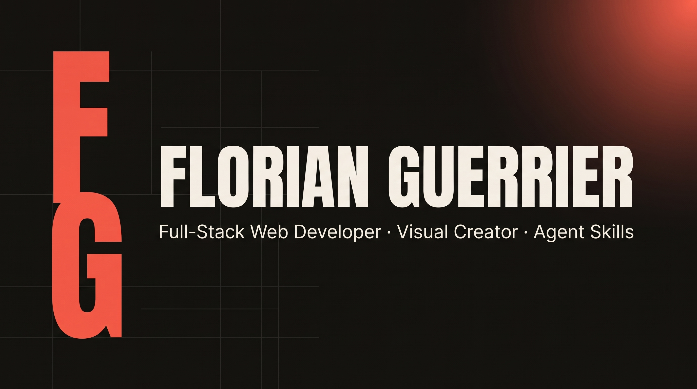

<div align="center">
  

  <br />

  <p>
    <a href="https://florianguerrier.com">
      
    </a>
    <a href="https://instagram.com/florianguerrier.dev">
      
    </a>
    <a href="mailto:contact@florianguerrier.com">
      
    </a>
  </p>

  <p>
    <strong>Full-Stack Web Developer & Visual Creator</strong> based in Southern France.<br />
    Building fast web apps, custom WordPress/WooCommerce architectures, native macOS utilities, and open-source <strong>Agent Skills</strong>.
  </p>
</div>

---

### Featured Open-Source Agent Skills

| Repository | Description | Stack |
| :--- | :--- | :--- |
| **[eu-web-compliance](https://github.com/Guerrier-florian/eu-web-compliance)** | Automated GDPR/CNIL consent gating, EAA 2025 accessibility, and LCEN/DSA footer compliance for AI coding agents. | `SKILL.md` · `Node 18+` · `Next.js / React` |
| **[wp-acf-to-blocks](https://github.com/Guerrier-florian/wp-acf-to-blocks)** | Surgical migration workflow from legacy ACF Pro themes to native Gutenberg blocks (`block.json` v3) with zero `post_meta` loss. | `SKILL.md` · `WordPress 6.6+` · `Node 18+` |

---

### Core Stack

```text
Frontend & UI    →  React · Next.js · TypeScript · Tailwind CSS · Figma · Affinity Designer
CMS & E-commerce →  WordPress (FSE / Gutenberg) · WooCommerce · Strapi
Backend & Infra  →  PHP · Node.js · PostgreSQL / Neon · Docker · Vercel
AI Workflows     →  Agent Skills (agentskills.io) · MCP · Local LLMs
```
